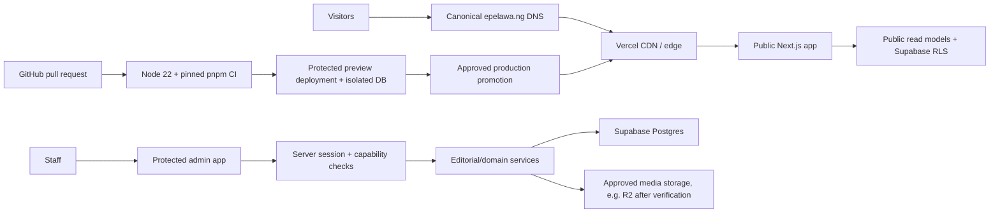

# EPE-LAWA — Project Audit and Systematic Remake Plan

**Audit snapshot:** 7 November 2026 · repository `epelawa/EPE-LAWA`, branch `main`, commit `2dbe4f8e37c4e007786690b614d6643d3639b524` (`chore: update dev script and env types`).

**Bottom line:** EPE-LAWA has a useful product, design and database foundation, but it is not currently a reliable release. The immediate problems are a failed latest production build, a missing canonical-domain DNS route, an admin app that both fails TypeScript checks and lacks a safe authorization boundary, and a mismatch between checked-in migrations and the live Supabase schema. Separately, the project documents do not agree on the first-release scope, publishing workflow, infrastructure or completion status. This is a release-control and integration problem—not a reason to discard the idea or rewrite everything at once.

This is an evidence snapshot and a recommendation, not a new approved product specification. No application code, database schema or production settings were changed for this audit; the only intended repository change is this document.

## At a glance

| Area | What I verified | What it means |
| --- | --- | --- |
| Production site | The attached `epelawa.vercel.app` and `epe-lawa.vercel.app` production aliases both serve the EPE-LAWA homepage with HTTP 200. The intended `epelawa.ng` hostname does not resolve in DNS. | The current site is reachable on Vercel-hosted addresses, but the intended public brand domain is unavailable. The deployment aliases are still serving a previous successful deployment; the latest production deployment failed. |
| Latest deploy | Vercel reports the latest production build for commit `2dbe4f8` as failed. Its build output cannot resolve local `home-data`, `dates`, `media` and `editorial-body` modules imported by the main app. Those files are absent from the checkout. | The latest code cannot become the current production release until these imports are restored or the pages are corrected and the build passes. |
| Main site | Source contains a partial public site: home, news, Who is Who, radio, contact, about, guidelines, legal and utility routes. Public news and directory pages query Supabase, but the production data tables are empty. Several first-release routes and documented interactions are absent or incomplete. | Some UI and data-access foundations exist; source presence is not proof that the current branch builds or that the features work end to end. |
| Admin | Direct TypeScript checking found 28 errors: unresolved `@epelawa/ui` imports and 21 possibly-undefined fetch-header arguments. Admin pages/actions do not enforce a verified staff session/capability at their boundary; actions use a service-role client. The edit form does not save its fields. | Do not expose or use the admin for real publishing until it compiles and its authentication, authorization, CSRF and persistence paths are implemented and tested. |
| Supabase | The connected EPE-LAWA project is healthy in `eu-west-3`. Its live migration ledger contains 7 applied versions; the repository has 13 migration files. The live project reports 21 tables, nearly all with zero rows; the capability catalogue has 12 rows. No Edge Functions are deployed. | The schema is only partly rolled out and has no real content or member activity. A handful of capability records do not mean the product is populated. |
| Delivery controls | The checkout has no `.github/workflows` files. Vercel build output warns that configured environment variables are missing from Turbo’s environment allowlist. Classic GitHub branch-protection inspection returned a plan/permission 403; required-check enforcement could not be verified. | There is no checked-in CI pipeline proving that a change builds, typechecks and passes tests before it is merged. |

## What is already working

The repository is organized as a pnpm/Turbo monorepo with separate main-site and admin apps, backend packages and Supabase migrations. It has meaningful product requirements, route maps, database documentation and a dedicated visual system. The UI guidance already establishes a distinctive “Modern Riverine Editorial” identity, mobile-first layout requirements and accessibility expectations rather than relying on a generic dashboard template ([design system](docs/05-design-system.md), [UI research](docs/15-ui-research.md)).

The main-site source has useful public-facing foundations: server-rendered news and people-directory reads, metadata and sitemap/robots handlers, contact form code, loading/error/not-found boundaries and some accessibility basics such as a skip link and labelled navigation. These are source-level capabilities; the latest build failure prevents treating the full app as currently releaseable ([main app](frontend/apps/main/app), [main app manifest](frontend/apps/main/package.json)).

The database work is not empty scaffolding. The SQL models editorial content and revisions, media/radio, people and verification, staff capabilities, audit events, member identity, comments, notifications, forum, business listings and marketplace/order records. It uses row-level security, constrained public projections and narrow grants in many places; the schema tests exercise useful policies and workflows ([migrations](backend/supabase/migrations), [schema tests](backend/tests/schema.test.mjs)). The important caveat is that those tests use a simulated Postgres environment and do not prove the live Supabase permissions, deployed migration contents, provider integrations or payment processing.

There are also useful design choices worth preserving: a consistent responsive shell; the deliberate Riverine palette and typography; explicit empty/loading/error/denied states in the design system; and backend helper packages for authentication, HTTP security and editorial transitions. The issue is that some helpers are not yet wired into real admin routes or production flows.

## Immediate blockers and production state

### 1. The newest production build is broken

The latest Vercel production deployment is marked `ERROR` for the current head. The main app imports files that are not present in the checkout: `frontend/apps/main/lib/home-data`, `dates`, `media` and `editorial-body`. Examples include the home page’s `../lib/home-data` import and the news/profile routes’ imports from `lib/dates`, `lib/media` and `lib/editorial-body` ([home page](frontend/apps/main/app/page.tsx#L1-L5), [news list](frontend/apps/main/app/news/page.tsx#L1-L5), [article page](frontend/apps/main/app/news/%5Bslug%5D/page.tsx#L1-L10), [people pages](frontend/apps/main/app/who-is-who/page.tsx#L1-L8)). The Vercel build log names these unresolved imports, and a repository inventory confirms the files are absent.

**First fix:** restore or implement the intended modules, or remove/rewrite the imports and affected UI. Then run the pinned Node 22 / pnpm 10.34.9 checks and a production-equivalent build. Do not assume the previous successful deploy means the current branch is healthy.

### 2. The intended `.ng` domain is not live

Both attached Vercel production aliases—[epelawa.vercel.app](https://epelawa.vercel.app/) and [epe-lawa.vercel.app](https://epe-lawa.vercel.app/)—currently return the actual EPE-LAWA homepage with HTTP 200. I verified the page title and returned HTML; this is not merely a 200 error page. The aliases currently send `Cache-Control: private, no-cache, no-store`, so the response is not being publicly CDN-cached.

By contrast, a direct request to [epelawa.ng](https://epelawa.ng/) fails because DNS cannot resolve the hostname, and `epelawa.ng` is not among the Vercel project’s attached domains. The earlier documentation describes `news.epelawa.ng` as a separate destination, but the current main app also implements local `/news` pages, so the host/canonical plan needs one decision. Fix the root and any intended `www`/news DNS records, attach and verify the domain in Vercel, select one canonical host, and verify redirects, TLS, canonical metadata, sitemap and robots output.

A deployment-specific hostname I tested first redirected to Vercel SSO; that was not one of the attached production domains. The verified production aliases above are public. Do not treat the earlier preview-host response as evidence that the production site is SSO-blocked.

### 3. Admin is both uncompilable and unsafe to operate

The admin imports `@epelawa/ui`, but no matching workspace package or dependency exists. TypeScript also reports 21 `fetch` header type errors where the key can still be undefined. Direct checking found 28 admin compile errors in total. The current pnpm install/build path was not run to completion in this sandbox: the available Node is 24.22.1, the global pnpm is 11.25.0, while app manifests call for Node 22 and the repository pins pnpm 10.34.9; the standard install prompted to remove and rebuild `node_modules`. The code-level TypeScript findings and hosted Vercel build evidence remain valid, but a clean full local test run is not claimed.

More seriously, admin pages render without checking a verified user session and active staff capability. The server action module uses a service-role Supabase client but does not call the provided authorization helper before mutations. There are no concrete login/logout routes or middleware wiring the helper into the app. The edit page renders fields but submits only the article ID/revision; the action calls `article_submit` and ignores submitted field values. The dashboard shows hard-coded zero counts and links to a missing publish page ([admin layout](frontend/apps/admin/app/layout.tsx#L30-L47), [admin actions](frontend/apps/admin/lib/actions.ts#L1-L56), [article edit page](frontend/apps/admin/app/newsroom/%5Bid%5D/page.tsx#L55-L105), [admin data client](frontend/apps/admin/lib/supabase.ts#L1-L20)).

**Safety rule:** leave admin publishing disabled until every page and mutation has server-side identity, capability, ownership/revision and CSRF/origin checks; then test unauthorized direct requests, session expiry/refresh/logout, save/edit/publish, and safe error handling against a real preview database. A hidden button or client-side route guard is not an authorization boundary.

## The agreed “first five” needs a written crosswalk

The handoff says five modules were agreed for the initial release, but the repository does not provide a clean, authoritative mapping. The PRD calls the baseline a five-module build and then labels seven modules; the master plan also lists seven product areas, and root `AGENTS.md` describes eight delivery items ([PRD](docs/01-product-requirements.md#L4-L8), [master plan](docs/00-master-plan.md#L33-L110), [agent instructions](AGENTS.md#L15-L29)).

The most plausible reading of the PRD numbering is that the first five are **News; Who is Who; Radio; member accounts/comments/notifications; and Forum**, with **Business Directory** and **Marketplace/Payments** deferred. That is a planning inference, not a confirmed client crosswalk. Before more implementation, write the five exact names, list what each includes/excludes, and mark directory/marketplace deferred if that matches the client agreement. Do not let future-module SQL or UI imply those modules are launch-ready.

| Provisional first-five area | Evidence in the current checkout/live project | Gap to close before calling it done |
| --- | --- | --- |
| News | Main app has `/news` and `/news/[slug]` source and queries a published-article view. | Latest build has missing imports; live tables have no articles; admin creation/editing is not a safe working workflow; the separate-news-host docs conflict with local `/news`. |
| Who is Who | Main app has index/profile source and published-people queries. | Live people data is empty; the list caps at 60 without search/pagination; the expected `dates`/`media` imports are missing; `/within` in the page spec conflicts with `/who-is-who` in the sitemap. |
| Radio | Radio page/player source and database tables exist. | No Edge Function is deployed; live stream/configuration rows are empty; schedule/archive routes are absent from the main app; stream URL, permission and actual playback are not verified. Active docs and commit log disagree on whether the stream is ready ([master plan](docs/00-master-plan.md#L57-L68), [tracker](docs/14-tracker.md#L191-L198), [commit log](COMMIT-LOG.md#L31-L47)). |
| Member accounts, comments, notifications | SQL migrations exist in the repository. | Six later migrations are not in the live migration ledger; no working member sign-in/session/account route flow was found in the main app; no corresponding Edge Functions are deployed. |
| Forum | SQL migration and page specifications exist. | Forum routes and usable thread/post/moderation UI are not present in the main app; the forum migration is not applied to the connected production project. |

The seventh-area SQL for Business Directory and Marketplace/Payments is not an implemented product merely because migration files exist. The marketplace migration explicitly lacks the order-creation, payment-provider, webhook and fulfillment functions needed for real transactions ([migration](backend/supabase/migrations/20261102200012_marketplace_and_payments.sql#L1-L13)). Keep it out of the first release unless the client confirms otherwise and the payment design receives a separate security review.

## Supabase and backend findings

### Live database versus repository

The connected Supabase project is healthy and in `eu-west-3`. Its migration ledger shows seven applied versions, ending at `20261102200006_staff_transitions`; the current checkout contains 13 migration files, ending at `20261102200012_marketplace_and_payments`. Versions `20261102200007` through `20261102200012` are therefore present in Git but not recorded as applied to this project. The repository’s status documents disagree: the README/backend README and schema runbook describe only the initial staff migration as applied, while the commit log says six and the tracker makes broader completion claims ([README](README.md#L11-L31), [backend README](backend/README.md#L1-L5), [schema runbook](docs/16-schema-runbook.md#L9-L19), [tracker](docs/14-tracker.md#L33-L120), [commit log](COMMIT-LOG.md#L51-L62)).

The live project reports 21 tables. Nearly all are empty; the capability catalogue contains 12 entries, while public content, people, stream, comments, forum, business and marketplace records are absent. This means empty lists on the public site may be an honest reflection of the current database, not proof that the feature is finished. The project has no deployed Supabase Edge Functions. Do not run the six pending migrations blindly against production: compare each migration to the live catalog, verify backups, replay on an isolated preview/branch, then release them one at a time with tests and a rollback/recovery plan.

### RLS and security advisories

RLS is enabled on the live tables, but the live catalog shows no policy for four tables: `article_version_tags`, `people_corrections`, `people_verifications` and `stream_config`. No policy generally means deny-all for browser roles, which can be an intentional safe default; confirm whether each is deliberately service-only. The production `people_verifications` catalog also has no column privileges for `anon` or `authenticated`, even though the checked-in people migration describes narrower public-column access and a staff policy. That is a concrete code/database drift item, not a reason to widen public access ([people migration](backend/supabase/migrations/20261102190004_people_directory.sql#L300-L411)). Decide the intended read path and add a new forward migration only after a real Supabase preview test.

Supabase’s live advisor also reports eight functions with mutable search paths, 25 unindexed foreign keys, and an extension located in the public schema. The eight inspected functions are invoker functions rather than `SECURITY DEFINER`, so this is an advisory to review and pin safe function configuration, not proof that an unauthenticated caller can take over the database. Before data grows, add indexes where query plans and FK access patterns justify them and move extensions out of `public` where Supabase recommends it.

The live catalog contains a `SECURITY DEFINER` event-trigger function called `public.rls_auto_enable`; `anon` and `authenticated` have `EXECUTE` according to the privilege check, and its body enables RLS on newly created public tables. It has a pinned `pg_catalog` search path and returns the special `event_trigger` type, so it is not an ordinary RPC function callable like a normal SQL function. Nevertheless, review its purpose and grants; revoke browser-role execute if it is unnecessary, and do not treat its presence as a substitute for testing policies on every table.

The SQL test harness is useful but deliberately substitutes or omits some production behavior, including real Supabase roles/JWT/PostgREST, extension semantics and pooler behavior ([schema test limitations](backend/tests/schema.test.mjs#L1-L20), [runbook gaps](docs/16-schema-runbook.md#L163-L176)). “Schema tests passed” must not be reported as “production RLS verified.”

## Why the project feels messy

The evidence points to several interacting process problems—not one bad coding decision:

1. **Scope was never made machine-readable.** “Five modules” coexists with seven numbered product modules, eight delivery items and a nine-phase plan.
2. **Decisions did not propagate.** The commit log records direct publishing, but active requirements, journeys, API contracts, security matrices and roadmap text still describe an independent review/approval workflow ([decision](COMMIT-LOG.md#L108-L130), [roadmap](docs/12-development-roadmap.md#L34-L58)). The project needs one chosen workflow.
3. **Status is not backed by one current evidence record.** Tracker, README, schema runbook and commit log report incompatible migration and completion states. The tracker carries an older update date despite later claims.
4. **Shared helpers were treated as if they were integrated features.** Backend auth/security/editorial packages exist, but admin routes/actions do not call them. Database tables exist for future modules without deployed routes/functions.
5. **A release gate is missing.** There are no checked-in GitHub Actions workflows, and the root audit commands point to an absent `scripts/audit/run.mjs`. The latest broken build shows why every PR needs build/typecheck/test gates before it lands on `main`.
6. **Provider choices and environment names drifted.** Active docs disagree between Vercel/R2 and Cloud Run/GCS. `.env.example`, main/admin code and Vercel use different Supabase variable names. Vercel build logs warn that environment variables are not declared in `turbo.json`; the inspected Vercel variables are scoped to production, not preview.

This is an inference about the process, not a claim about anyone’s intent. The practical cure is a smaller, evidence-gated vertical slice and a single source of truth—not another all-at-once rewrite.

## Recommended target architecture

Keep the first release as a **modular monolith**: one public Next.js app, one protected admin app, Supabase Postgres as the source of truth, and shared domain/security packages that are actually imported by route handlers and server actions. Do not introduce microservices just to make the diagrams look modern.

**Application boundaries.** Public routes should use a read-only public projection and RLS; member-specific pages must be private and uncached. Admin authorization must be checked on the server for every route and mutation. Prefer a user/JWT-scoped client and RLS for ordinary operations; reserve service-role credentials for narrowly defined, audited server tasks. Connect the existing auth, HTTP-security and editorial packages to real routes, or remove the unused abstractions.

**Data and migrations.** Postgres remains the durable source of truth. Every migration is additive/forward-only, tested on a clean local or preview database, compared against production catalogs, and deployed as an explicit release step. Keep migrations out of browser bundles. If a migration or release fails, stop promotion and use a tested restore/forward-fix plan; do not edit an already-applied migration and assume production changes with it.

**File storage.** The repository docs select Cloudflare R2, and the Vercel production environment contains R2 variable names, but successful upload/download, access controls and lifecycle rules were not verified. Confirm one storage provider and test the full signed-upload/read flow before stating it is configured. Never expose storage secret keys to the client. The older GCS/Cloud Run references should be marked superseded if Vercel/R2 is the chosen direction ([integrations](docs/10-integrations.md#L1-L59), [tech stack](docs/13-tech-stack.md#L78-L97)).

**Environments and server management.** Establish isolated local, preview and production configuration. Preview must point to a non-production Supabase project/branch and safe test credentials; the inspected Vercel variables are production-only. Replace the `.env.example` concrete project URL with a placeholder, standardize `SUPABASE_URL`, anon/publishable key and service-role naming, validate required server variables at startup, and never log their values. Add application error reporting, a health check, database/connection monitoring, backup/PITR verification, a documented restore drill and a tested rollback/forward-fix process. Co-locate server functions with the database only after measurement: Vercel’s inspected deployment region is `iad1`, while Supabase is `eu-west-3`, so database round-trip latency may be avoidable. Keep public assets and suitable pages at the edge.

**Delivery flow.** A PR should run frozen install, typecheck, unit/schema tests and production builds on Node 22/pnpm 10.34.9; a preview should smoke-test all implemented routes and basic DB access. Promote only after checks pass. The GitHub API refused classic branch-protection inspection with a 403 saying the private repository needs a plan upgrade or to be public; rulesets were not inspected. Check which repository ruleset/check-gating option is available before relying on required checks.

## Caching and Redis: what to do and what not to do

The main app currently opts into `force-dynamic`, which makes routes request-time and undermines reusable public-page caching; the live responses are explicitly `private, no-store`. Vercel remote caching in the build log is **build artifact caching**, not a cache for news/database reads. First decide the freshness requirements for each public data class, then selectively cache public, non-user-specific news lists, profiles and directory reads using supported Next.js 16 cache APIs and/or CDN response caching. Attach cache tags to those data sets and invalidate/revalidate them after publish, edit, unpublish or correction. Test that a changed story appears within the agreed freshness window.

Never CDN-cache admin, session, member-specific or otherwise private responses. Keep them `private, no-store`. Avoid a blanket dynamic layout for public pages where static shell + selectively dynamic data can work. Validate cache headers, revalidation and cache invalidation on a real deployment before calling the performance work done. The applicable official guidance is [Next.js caching and revalidation](https://nextjs.org/docs/app/guides/caching-without-cache-components), [Vercel Data Cache](https://vercel.com/docs/caching/runtime-cache/data-cache) and [Vercel CDN cache](https://vercel.com/docs/caching/cdn-cache); Next.js 16 Cache Components and the previous caching model differ, so choose based on the app’s actual config.

**Do not add Redis yet.** No measured throughput or contention problem currently justifies another managed service. Use Postgres for durable records, transactions, modest shared counters/locks and audit history; use Vercel/Next caching for public content. Add Redis only when telemetry shows a concrete bottleneck (for example, high-volume ephemeral rate limits, fan-out or queue throughput) and the team has defined persistence, eviction, outages, reconnect and fallback behavior. Redis is an optional later tool, not a missing foundation.

## UI direction using Sckooly and Quant

I reviewed the public [Sckooly](https://sckooly.app/) and [Quant](https://www.getquant.app/) pages and their publicly served stylesheets. Sckooly uses a strong student-focused hero, audience/role framing, numbered sections, product demonstrations and repeated calls to action. Its inspected stylesheet uses red accents (`#DA251C`, `#FF4A3D`), charcoal and warm neutral surfaces. Quant is more conversion-focused: a WhatsApp-first action, a short workflow, feature explanations and FAQs; its inspected stylesheet uses orange (`#f60`), blue (`#006dff`), cyan and pale blue surfaces. Their font stacks also differ: Sckooly includes Instrument Serif with Plus Jakarta Sans, while Quant uses Plus Jakarta Sans and Source Code Pro.

**Recommended EPE-LAWA direction:** borrow their clarity and section rhythm, not their product identity or exact colors. Retain the already approved EPE-LAWA palette—Riverine Teal `#0B5A60`, Palm Green `#2E7D32`, Ochre Gold `#E5A93C`, Deep Charcoal `#1C1E21` and Warm Ivory `#F9F8F6`—unless the owner explicitly approves a brand change ([UI research](docs/15-ui-research.md#L28-L38), [design tokens](docs/05-design-system.md#L29-L74)). Gold is an accent/surface with dark text, not text on ivory.

Use a clear local-news masthead, one strong public-purpose hero, a single primary newsroom action, a concise “how it works” story, genuine editorial/public-record/radio sections, visible standards and real contact routes. Use numbered sections only where they help people understand the product; do not fill the homepage with invented cards, fake metrics, stock imagery or unfinished modules. Keep the news experience newspaper-like and readable, not SaaS-like. Preserve the directory’s civic purpose and make any “verified” label truthful and explained. Radio must state the real stream status and must not claim “LIVE” without a verified feed. Use authentic, licensed Epe imagery with credits; do not reuse reference-site assets.

For admin, use the same tokens with a restrained operations layout: truthful counts, a visible capability boundary, compact tables that work on phones, safe action confirmations and clear save/publish feedback. Do not build an admin façade around buttons that do nothing. Keep mobile navigation, 44px touch targets, contrast, focus states, 200% text zoom and loading/empty/error/denied states as acceptance criteria, consistent with the existing design system.

## A safer remake sequence

### Phase 0 — Freeze decisions before implementation

Publish one scope crosswalk: the exact five client-approved modules, their routes, user roles, data sources and acceptance checks. Confirm whether News is direct-publish or review-before-publish; the current documents disagree. Decide whether news is on `epelawa.ng/news` or a separate news host. Confirm Vercel/Supabase/R2 versus any superseded GCP/GCS plan, and record whether the radio stream and its embedding rights are verified. Mark every status as **implemented**, **deployed**, **verified**, **planned** or **blocked**—never use these as synonyms.

### Phase 1 — Restore a green, reachable release

Resolve the main-app imports and admin package/type errors. Pin and use the declared Node/pnpm versions. Add PR CI and a release smoke test. Fix Turbo environment pass-through, align the env schema and add a non-production preview environment. Restore the intended `.ng` DNS/domain and choose the canonical host; confirm the page, robots and sitemap are reachable from an unauthenticated browser. This phase ends only when the current branch builds and the production domain points at the verified deployment.

### Phase 2 — Secure and reconcile backend/admin

Compare live schema and policies against all 13 repository migrations. Reconcile the six unapplied versions on an isolated Supabase preview; add missing or corrected policies as forward migrations. Decide which RLS-no-policy tables are server-only. Test anon, member, staff-with-capability and service-role behavior using real Supabase/PostgREST. Wire auth and CSRF/origin checks into the admin boundary, replace unrestricted service-role page/action usage, and implement persistent save/edit flows. Leave admin unavailable to staff until direct unauthorized requests fail safely and all authorized workflows pass.

### Phase 3 — Complete only the approved five-module vertical slice

For each confirmed module, finish a thin end-to-end path: real user action → authenticated/authorized server route → database operation/RLS → persisted state → visible success/error and audit record. Add honest empty, denied and retry states. Reconcile `/news` host, `/within` route, sitemap, navigation and page specs in one route matrix. For directory/news, implement search and pagination where the approved requirements demand it. For radio, prove source, rights, device playback and offline state. For member/forum routes, do not present the feature as ready until migration, UI, authorization and moderation lifecycle are complete.

### Phase 4 — UI, performance and operational hardening

Apply the reference-inspired hierarchy using EPE-LAWA’s own palette. Test every implemented route on desktop and a real narrow mobile viewport; keyboard, focus, reduced motion, 200% text zoom, contrast, slow/offline data and large/empty/error datasets. Add selective public caching and publish-time invalidation; benchmark query and region latency. Verify backup retention, perform and record a restore drill, define alerts, and exercise the release rollback/forward-fix path.

### Phase 5 — Defer remaining product areas until separately approved

If Business Directory and Marketplace are outside the first five, keep them visibly out of the launch navigation and do not imply their SQL schemas mean they are live. Bring each forward only with a new scope/acceptance review. Marketplace additionally needs server-computed totals, provider signature validation, idempotent webhook processing, order/payment state transitions, reconciliation and replay tests before any real money can be handled.

## Decisions and items still needed

1. Confirm the exact five modules and whether the provisional PRD modules 1–5 mapping is right.
2. Confirm the publishing workflow: direct publish or separate reviewer/publisher approval.
3. Confirm the canonical public host and DNS ownership/configuration for `epelawa.ng` and any news subdomain.
4. Confirm the selected media provider and the verified radio URL, format and permission to embed it.
5. Confirm whether the four no-policy RLS tables are intentionally server-only, especially people-verification reads.
6. Confirm which branch ruleset/required-check option is available for the private GitHub repository.

## Audit coverage and limits

I read the inventoried active and archived Markdown/MDX project documents, reviewed the main and admin route/source surfaces, backend helper packages, all 13 migration files and schema tests, the current Git/deployment configuration, and the connected Supabase and Vercel project state. I also checked the public production aliases and canonical-domain DNS directly. I did not run a full local install/build/test suite or an interactive desktop/mobile end-to-end test: the sandbox runtime differs from the repository’s declared app runtime, the dependency reinstall requested destructive `node_modules` cleanup, and the current production source has known compile blockers. The latest Vercel build log and direct admin TypeScript diagnostics provide current failure evidence; there is no current full-route browser/accessibility certification. The live Supabase audit was read-only; no migration, policy or production setting was changed.
