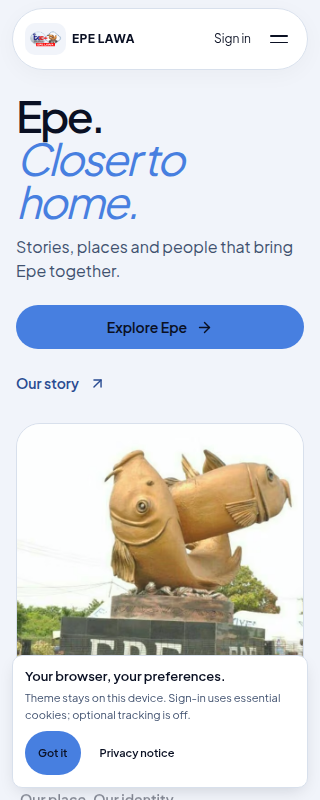
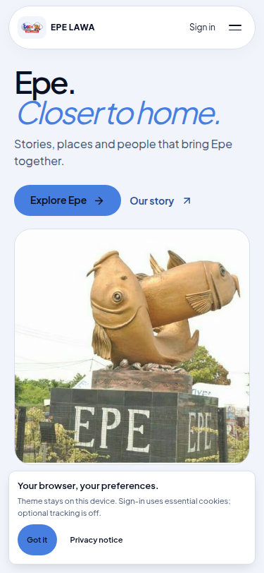
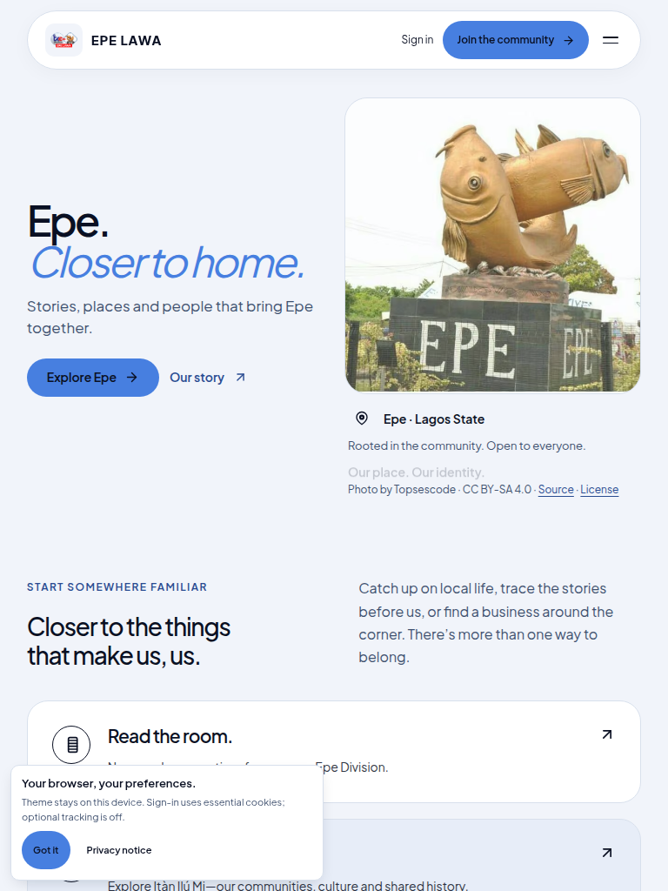
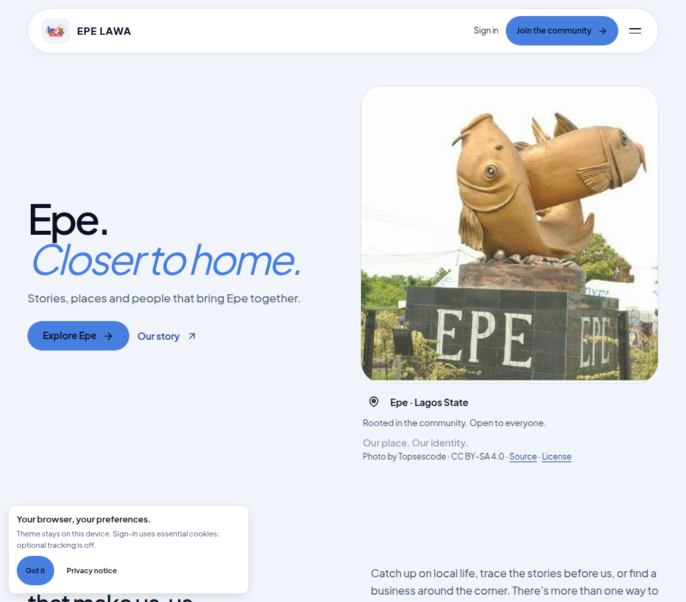
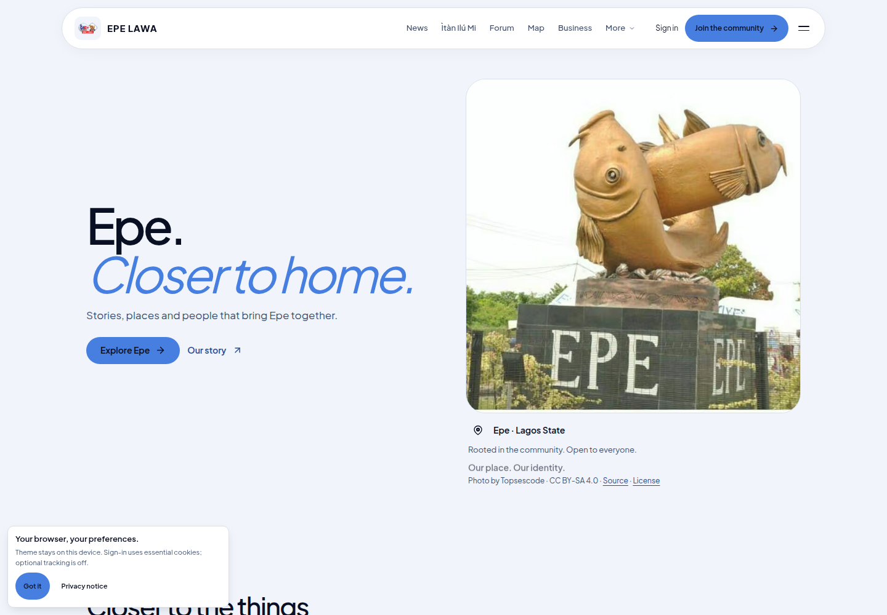

# Homepage hero refinement screenshots — 2026-11-14

Screenshots were captured from the local app at `http://127.0.0.1:3122/` using only dummy Supabase values. The cookie banner remains at its existing viewport-bottom position.

| Viewport | Capture |
| --- | --- |
| 320 × 800 |  |
| 375 × 812 |  |
| 768 × 1024 |  |
| 1024 × 900 |  |
| 1440 × 1000 |  |

Validated on this branch: `node_modules/.bin/tsx --conditions=react-server --test --test-name-pattern='homepage hero|public Appearance' frontend/tests/design-polish.test.mjs frontend/tests/foundation.test.mjs frontend/tests/ui-rebuild.test.mjs` (3 passed); `frontend/apps/main/node_modules/.bin/tsc --noEmit -p frontend/apps/main/tsconfig.json` (passed); `(cd frontend/apps/main && ./node_modules/.bin/next build --webpack)` (passed).
