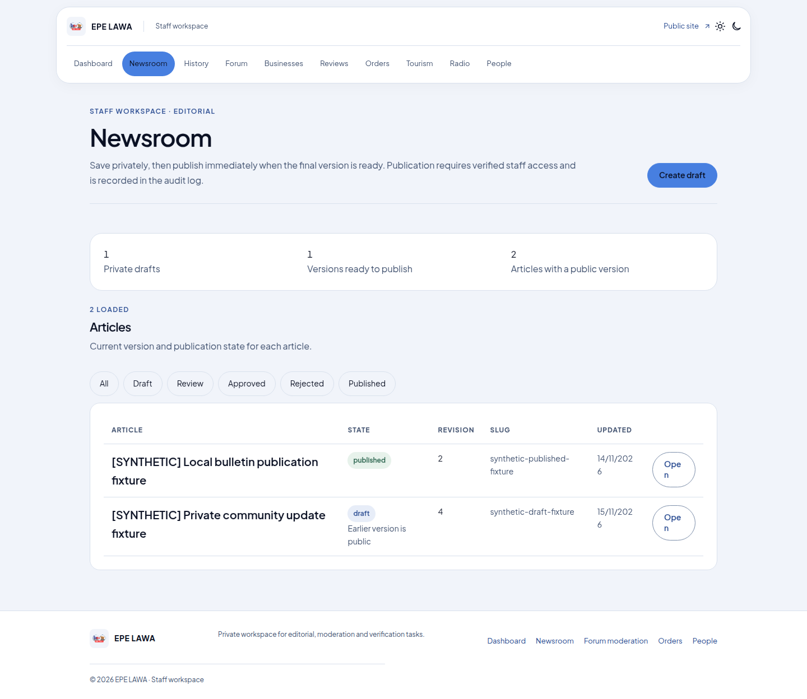
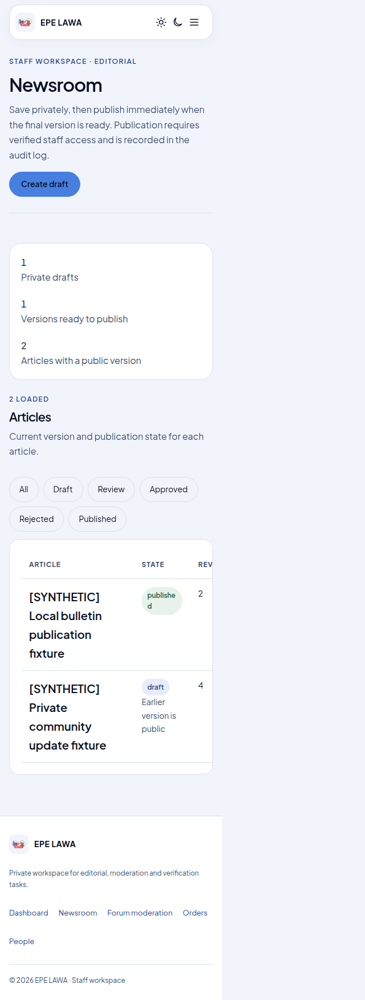

# Admin Newsroom synthetic screenshots — 2026-11-15

These captures use a loopback-only HTTPS mock for Supabase Auth and PostgREST, a synthetic staff identity, and two explicitly labeled fixture articles. No Production rows, accounts, credentials, or public content were read or changed. The local Admin route returned HTTP 200. One browser console warning reported a 404 resource; no JavaScript page exception was observed.

## Desktop — 1440px

The first fixture shows `Published` when `published_version_id` matches `current_version_id`. The second shows a current private draft plus “Earlier version is public” when the pointers differ.

## Mobile — 390px viewport

The full-page capture measures 641px wide and the browser reports horizontal document overflow at a 390px viewport. The table itself has horizontal scrolling, but this page-level overflow is a remaining responsive issue and is not claimed as fixed by the schema repair.