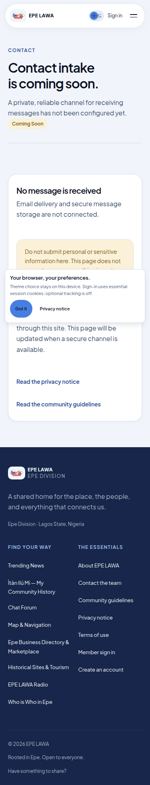
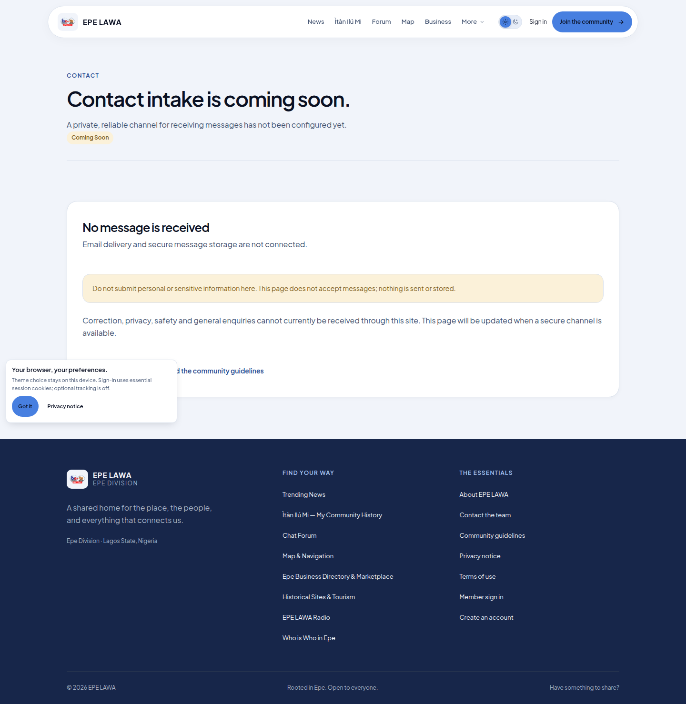

# PR #28 — local public-contact and privacy screenshots

These captures were made against the local production-mode app with synthetic `.invalid` service endpoints and dummy keys. They are **local** UI evidence only, not hosted-preview or production screenshots. No production records or messages were used. The mobile captures are full-page 375px-wide views; desktop captures were rendered at 1440px wide.

The Contact captures show that the site receives or stores no message and expose no private admin mailbox. They predate PR #31, so the preference notice still appears on informational pages; that separate PR is intended to keep it on the homepage only. The Contact page also still contains a “Coming Soon” label in these PR #28 captures; PR #32 has the follow-up wording change. Do not use these images to claim those later fixes are already live.

## Contact

## Other affected public pages

| Page | Local mobile | Local desktop |
| --- | --- | --- |
| About | [375px full page](local-375x812-fullpage-about.png) | [1440px full page](local-1440x900-fullpage-about.png) |
| Community guidelines | [375px full page](local-375x812-fullpage-guidelines.png) | [1440px full page](local-1440x900-fullpage-guidelines.png) |
| Privacy | [375px full page](local-375x812-fullpage-privacy.png) | [1440px full page](local-1440x900-fullpage-privacy.png) |
| Terms | [375px full page](local-375x812-fullpage-terms.png) | [1440px full page](local-1440x900-fullpage-terms.png) |
