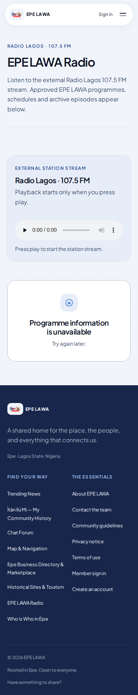
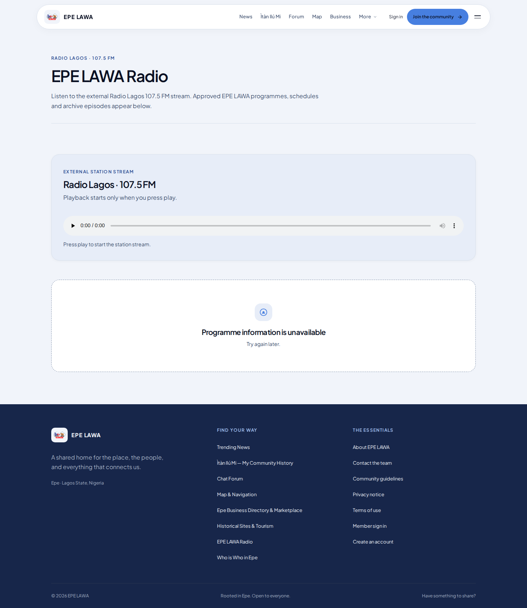

# Radio programme fallback — 2026-11-14

These screenshots come from a local production-mode build. A loopback-only synthetic Supabase endpoint returned HTTP 500 for programme data so the genuine programme-unavailable state could be checked without touching the EPE-LAWA project or Production. The browser made no external requests, and the station player was left idle (no autoplay or audio request).

Both widths rendered without horizontal overflow. The page shows the concise programme-only error while preserving the separate Radio Lagos 107.5 FM player.

- [375px mobile capture](radio-error-375px.png)
- [1440px desktop capture](radio-error-1440px.png)
- [Browser/layout metrics](metrics.json)

