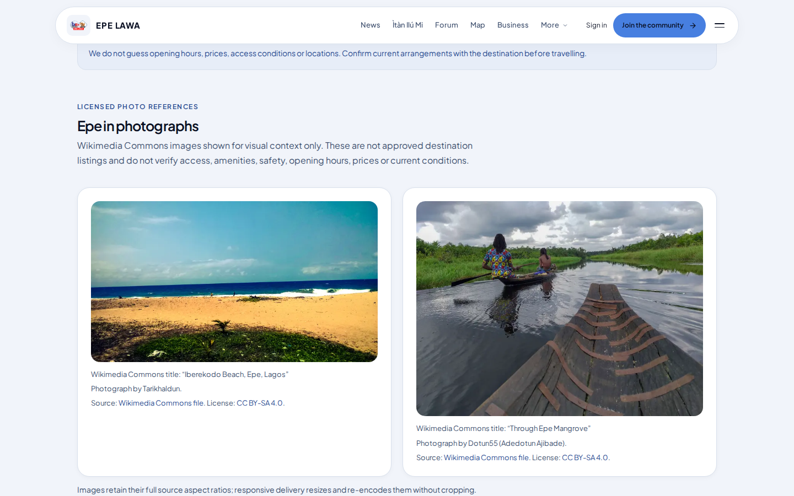

# Tourism photo-reference QA captures

**Status:** Local candidate only. These screenshots are not a Production deployment or evidence of approved destination records.

The gallery was checked at 320, 375, 768, 1024 and 1440 CSS px. Each width has a gallery-centered viewport capture plus a full-page capture:

| Width | Gallery viewport | Full page |
| --- | --- | --- |
| 320px | [View](tourism-320px.png) | [View](tourism-full-320px.png) |
| 375px | [View](tourism-375px.png) | [View](tourism-full-375px.png) |
| 768px | [View](tourism-768px.png) | [View](tourism-full-768px.png) |
| 1024px | [View](tourism-1024px.png) | [View](tourism-full-1024px.png) |
| 1440px | [View](tourism-1440px.png) | [View](tourism-full-1440px.png) |

## What was verified

A local production build and loopback-only Supabase mock were used; external origins were blocked, no Production records were read or written, and the mock only exercised an honest unavailable/empty destination state. Playwright confirmed the photo-reference section and both license/source credits were visible at all five widths, there was no horizontal overflow or browser-console error, and the one-time theme notice was dismissed with its accessible control. Images were served through the Next.js optimizer; rendered dimensions retained the original aspect ratios within the test tolerance, without cropping.

The references are Wikimedia Commons files: “Iberekodo Beach, Epe, Lagos” by Tarikhaldun and “Through Epe Mangrove” by Dotun55 (Adedotun Ajibade), both CC BY-SA 4.0. The candidate page labels them as visual references, not verified destination listings; the images do not establish access, amenities, safety, hours, prices or current conditions. Full source and license records are in [`epe-photo-attributions.txt`](../../../../frontend/apps/main/public/epe-photo-attributions.txt).

## Limits

This evidence does not verify any approved Tourism destination, visit details, production database behavior, member submission delivery, public media hosting or a hosted preview. The Tourism module remains incomplete; do not mark the full module released based on the photo gallery.
