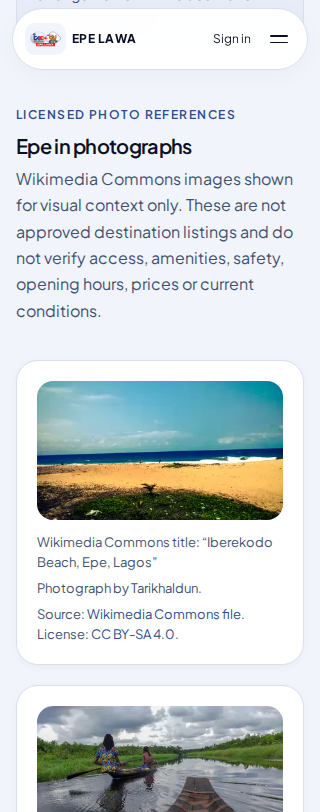

# Tourism photo-reference screenshots — 2026-11-14

**Status:** Local candidate evidence only; this is not a Production deployment or an approved destination guide.

The page was captured in local production mode at five responsive widths. Each width has a gallery-focused viewport screenshot and a full-page capture.

| Viewport | Gallery view | Full page |
| --- | --- | --- |
| 320 × 812 | [View](tourism-320px.png) | [View](tourism-full-320px.png) |
| 375 × 844 | [View](tourism-375px.png) | [View](tourism-full-375px.png) |
| 768 × 1024 | [View](tourism-768px.png) | [View](tourism-full-768px.png) |
| 1024 × 900 | [View](tourism-1024px.png) | [View](tourism-full-1024px.png) |
| 1440 × 900 | [View](tourism-1440px.png) | [View](tourism-full-1440px.png) |

## What was verified

Chromium loaded the local `/tourism` route successfully at all five widths against a loopback-only HTTPS Supabase mock returning no destination records and no signed-in user. The route showed the truthful “No approved destinations yet” state, both photo references and both CC BY-SA 4.0 credits. There was no horizontal overflow, image cropping, page/console error, unexpected failed response, or external browser request. The one-time appearance notice was dismissed through its accessible control before each screenshot; reduced-motion mode was enabled.

The browser used only localhost/127.0.0.1. Test configuration used a local dummy Supabase key and a temporary localhost certificate; no production database, records, credentials or settings were contacted or changed. The actual image files and visible source/license links are part of the candidate branch.

## Attribution and limits

The images are “Iberekodo Beach, Epe, Lagos” by Tarikhaldun and “Through Epe Mangrove” by Dotun55 (Adedotun Ajibade), both licensed CC BY-SA 4.0. They are explicitly presented as visual references, not approved tourism destinations. No claim is made about access, amenities, safety, hours, prices, current conditions or coordinates. The Tourism module remains incomplete until approved destinations and verified visiting details are available and the full production workflow is safely tested.
